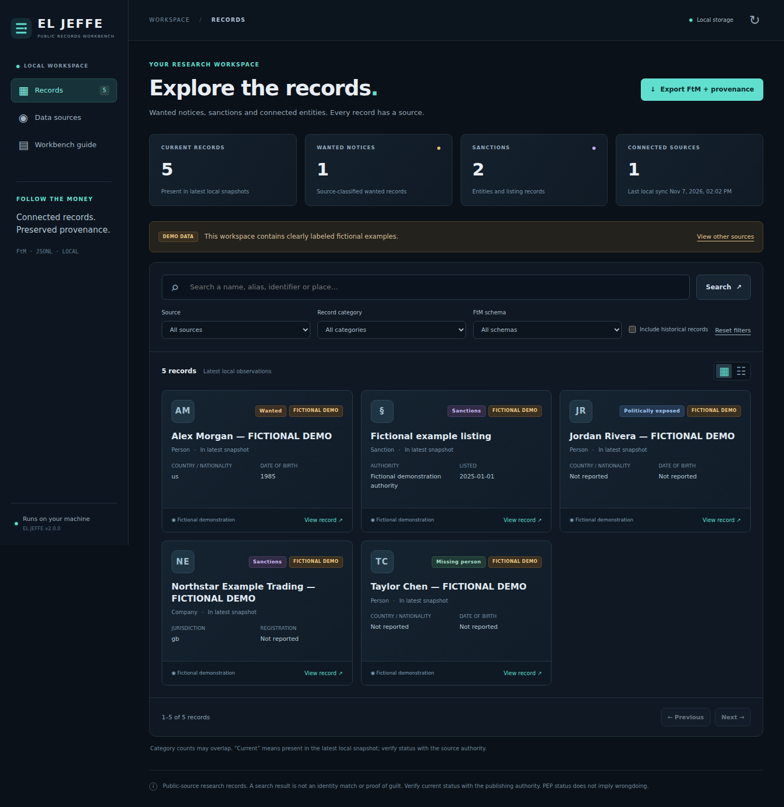

# EL JEFFE — public records workbench

A local **FBI + OpenSanctions** research workbench for the COPLINK project, with a
**macOS / Windows / Linux CLI**, a **Chrome / Chromium browser GUI**, and
**FollowTheMoney (FtM) JSONL** imports and exports.

Requires **Python 3.10+**, with **no third-party runtime dependencies**. The original
Ruby project remains available in `lib/`, `bin/`, `config/`, and `db/`; its README
is preserved in [docs/LEGACY_README.md](docs/LEGACY_README.md). The new application
is in `eljeffe/` and uses a separate local database.



## Quick start

```sh
git clone https://github.com/CRYPTOJEFFE/fbi-most-wanted-eljeffe.git
cd fbi-most-wanted-eljeffe
```

While version 2 is under review, select its branch:

```sh
git switch feat/opensanctions-ftm-workbench
```

### macOS (Intel or Apple silicon) and Linux

From the repository folder:

```sh
python3 --version
python3 -m eljeffe sync opensanctions --dataset us_fbi_most_wanted
python3 -m eljeffe sync opensanctions --dataset us_ofac_sdn
python3 -m eljeffe serve --open
```

### Windows

From PowerShell or Command Prompt in the repository folder:

```powershell
py -3 --version
py -3 -m eljeffe sync opensanctions --dataset us_fbi_most_wanted
py -3 -m eljeffe sync opensanctions --dataset us_ofac_sdn
py -3 -m eljeffe serve --open
```

If `py` is unavailable, use `python`. No administrator access or PowerShell
execution-policy change is needed. Download Python from
[python.org](https://www.python.org/downloads/) if needed.

Open **http://127.0.0.1:8765** in Chrome, Edge, Brave, or another Chromium browser.
`--open` starts your default browser; paste the URL into Chrome if necessary.
Keep the terminal open while using the GUI; Ctrl+C stops the server.

Convenient launchers:

- macOS GUI: `sh scripts/launch-gui.command`.
- Linux/macOS CLI: `sh scripts/eljeffe.sh --help`.
- Windows GUI: double-click `scripts\launch-gui.cmd`.
- Windows CLI: `scripts\eljeffe.cmd --help`.
- Optional command installation: `python -m pip install .`, then `eljeffe --help`.

The launchers use a project `.venv` when present. Running from source with
`python -m eljeffe` does not require pip, Ruby, a JavaScript build, or an API key
for non-commercial OpenSanctions bulk downloads.

## Features

| Capability | Behavior |
| --- | --- |
| OpenSanctions website discovery | Scrapes the selected official dataset page, respects robots directives, and discovers published files. Uses the metadata index and native FtM export as data authority. |
| Verified downloads | Stages files, checks publisher SHA1/size/entity count when supplied, records SHA256, and parses the full JSONL stream before committing. |
| FBI API | Paginates official public notices; preserves missing values, source classifications and warnings; capped/incomplete fetches do not retire unseen records. |
| Distinct record categories | Wanted, sanctions, PEP, missing-person and other notices remain distinguishable. Multi-topic records can appear under more than one filter. |
| Local search | Names, aliases, IDs, former IDs, and property text; source/category/FtM schema filters and pagination. |
| Typed relationships | Links come from entity-reference properties in the official FtM model, never from a name that happens to equal another ID. |
| Provenance | Raw snapshots, publisher/source URLs, versions, dates, checksums, dataset membership and import history. |
| Source changes | A completed source snapshot marks absent records historical. Failed or partial updates preserve existing records. |
| Official files | On-demand FBI PDF/image downloads with official-host restrictions, signature checks, size limits and per-file SHA256. |
| Portable exports | CLI: FtM JSONL plus manifest. GUI: ZIP containing JSONL and matching source/attribution/checksum manifest. |
| Browser UI | Search, details, relationships, source updates, file imports, export, and explicitly fictional demo data; no external CDN scripts/fonts. |

## Source presets

| Dataset ID | Coverage |
| --- | --- |
| `us_fbi_most_wanted` | FBI person notices included by OpenSanctions |
| `us_dea_fugitives` | US DEA fugitives |
| `us_ss_wanted` | US Secret Service fugitives |
| `us_ice_wanted` | US ICE wanted notices |
| `eu_europol_wanted` | European wanted notices |
| `interpol_red_notices` | Published INTERPOL Red Notices |
| `us_ofac_sdn` | OFAC sanctions and associated FtM records |
| `default` | Large consolidated OpenSanctions collection, including relationships, PEPs and organizations |

Any valid published dataset identifier can be supplied to `--dataset`. A preset
does not guarantee future publisher availability. Individual source exports are
smaller but omit facts obtained from enrichment sources. OpenSanctions recommends
`default` for comprehensive coverage. Do not interpret all members of `default`,
`crime`, or a sanctions list as wanted people.

The HTML scraper is limited to official dataset pages and, on demand, official
FBI source pages. Structured exports retain details and relationships that would
be lost when reconstructing records from rendered profiles. When an HTML page
cannot be read, the importer can use the published metadata index and records
that fallback in the manifest.

Unchanged, checksum-verified downloads are reused. Follow the publisher's update
guidance: full downloads no more often than every six hours; metadata polling
about every 30 minutes if needed. This application does not create scheduled tasks.

## CLI commands

`--data-dir PATH` goes **before** the command. `ELJEFFE_DATA_DIR` is an alternative.
Examples use `python3`; substitute `py -3` on Windows.

```sh
# Workspace and source discovery.
python3 -m eljeffe --data-dir ./data init
python3 -m eljeffe discover us_fbi_most_wanted

# Current snapshots and a partial diagnostic fetch.
python3 -m eljeffe sync opensanctions --dataset us_fbi_most_wanted
python3 -m eljeffe sync opensanctions --dataset us_ofac_sdn
python3 -m eljeffe sync fbi
python3 -m eljeffe sync fbi --max-pages 1 --json

# Search people, sanctions and aliases.
python3 -m eljeffe search --kind wanted --schema Person --limit 25
python3 -m eljeffe search --kind sanction --json
python3 -m eljeffe search "example alias" --source opensanctions:us_fbi_most_wanted

# A RECORD_ID is the exact identifier in search results, not a name.
python3 -m eljeffe show RECORD_ID --source opensanctions:us_fbi_most_wanted
python3 -m eljeffe files RECORD_ID --source opensanctions:us_fbi_most_wanted

# Local flat JSONL import, audit and historical records.
python3 -m eljeffe import ./entities.ftm.json --source import:my-source
python3 -m eljeffe sources
python3 -m eljeffe stats
python3 -m eljeffe history
python3 -m eljeffe search --include-inactive --json

# Export and schema/property checks.
python3 -m eljeffe export --source opensanctions:us_fbi_most_wanted --output ./exports/fbi.ftm.json
python3 -m eljeffe validate ./exports/fbi.ftm.json

# Browser UI or explicitly fictional example records.
python3 -m eljeffe serve --open
python3 -m eljeffe demo
```

Imports accept plain/gzip flat FtM JSONL, not a JSON array or a nested API response.
Use `--source` when an ID appears in multiple source snapshots. JSON results go
to stdout; progress and errors go to stderr. Exit codes: 0 success, 1 missing
`show` record, 2 input/source errors, 130 interruption.

### FollowTheMoney interoperability

Each line has `id`, `schema`, and `properties`. Properties contain arrays of
strings; reference properties contain entity IDs. Existing IDs, `datasets`,
`referents`, `first_seen`, `last_seen` and `last_change` are retained when supplied.
Local paths, attachments and application state remain outside the FtM entity.

`validate` checks JSON structure and schema/property names against the bundled
**FtM 4.11.3** model. It is **not full upstream value normalization or ontology
validation**. Imports preserve structurally valid custom/new schemas. Typed-link
navigation uses recognized reference properties.
[Model source, attribution and update instructions](docs/FTM_MODEL.md).

Records are keyed by `(source, entity ID)`. No automatic name matching or identity
merging occurs. Source-declared `referents` can resolve a former ID; historical
records expose active successors when declared by the source.

Export constraints:

- If selected sources reuse an ID, select one source for export. Potentially
  conflicting source assertions are not silently merged.
- FtM snapshots contain current observations only. Historical records remain
  searchable and inspectable, but are not exported as if current. Clear
  “include historical” before export.
- Filtered exports may omit referenced entities. Export an entire source without
  search/category/schema filters when you need its complete available graph.
  The details drawer shows up to 100 related records and reports any truncation.

## Local data and evidence

| System | Default folder |
| --- | --- |
| macOS | `~/Library/Application Support/ElJeffe` |
| Windows | `%LOCALAPPDATA%\ElJeffe` |
| Linux | `$XDG_DATA_HOME/eljeffe` or `~/.local/share/eljeffe` |

The folder contains `records.sqlite3`, raw source files and manifests in `cache/`,
browser uploads in `imports/`, and official files in `attachments/`. Downloaded
records and databases are ignored by Git. For backups, stop the application and
copy the complete data folder; copying a live SQLite file without its WAL can
omit pending data.

The server binds only to `127.0.0.1`, validates Host and same-origin writes, uses
a per-process request token and content security policy, and does not serve
arbitrary workspace files. It is a local browser app, not a browser extension or
a remote multi-user server. There is no service worker or remote authentication.

### Local API

Read endpoints: `/api/config`, `/api/stats`, `/api/entities`,
`/api/entities/{id}?source=...`, `/api/history`, `/api/export`.
`/api/export?bundle=1` downloads JSONL and provenance from the **same database read
snapshot**. Plain `/api/export` returns JSONL; `/api/manifest` reports current
provenance independently.

Mutation endpoints `/api/sync`, `/api/import`, `/api/demo`, `/api/files` require
`Content-Type: application/json` and `X-CSRF-Token` from `/api/config`. Jobs are
inspected at `/api/jobs/{id}`. Browser file imports are limited to 20 MB; use the
CLI for larger files. The GUI displays failed updates and preserves the previous
committed snapshot.

## Portable package and tests

```sh
python3 scripts/build_zipapp.py
python3 dist/eljeffe.pyz --help
python3 dist/eljeffe.pyz serve --open
python3 -m unittest discover -s tests -v
```

The `.pyz` includes the CLI, GUI and model assets. **It requires Python 3.10+**;
it is not a signed macOS app or Windows executable with an embedded interpreter.
GitHub Actions publishes portable-package artifacts from the OS matrix.

Browser tests use Playwright as a development dependency:

```sh
npm install --no-save playwright@1.62.1
npx playwright install chromium
node tests/browser_smoke.cjs
```

`CHROME_EXECUTABLE` selects an existing compatible browser;
`PYTHON_EXECUTABLE` selects the test server's Python. CI targets Linux, Windows,
macOS Intel, macOS Apple silicon, and Chromium. See
[docs/VALIDATION.md](docs/VALIDATION.md) for **observed results and limitations**,
separate from configured coverage.

## Interpretation, attribution and licensing

This independent research tool is not affiliated with the FBI, OpenSanctions or
INTERPOL. A record is not proof of identity or guilt. Verify current legal status
with the publishing authority. Retrieval/observation time differs from the
notice date; `last_seen` does not prove current wanted status. Disappearance from
an export does not establish exoneration. PEP status alone does not imply
wrongdoing. An INTERPOL Red Notice is an alert, not an international arrest warrant.

OpenSanctions bulk data is available under **CC BY-NC 4.0 for non-commercial use**;
commercial use requires a data license. Attribution and source terms travel in
the manifests. The software license does not supersede data terms.

The original [LICENSE.md](LICENSE.md) and author attribution remain intact; no
wholesale relicensing of the legacy educational code is implied. The upstream FtM
model's MIT copyright/license is in [docs/FTM_MODEL.md](docs/FTM_MODEL.md).

Primary references:

- [OpenSanctions bulk data](https://www.opensanctions.org/docs/bulk/)
- [Downloads, checksums, updates and deletions](https://www.opensanctions.org/docs/bulk/updates/)
- [Dataset metadata](https://www.opensanctions.org/docs/metadata/)
- [Non-commercial data use](https://www.opensanctions.org/docs/commercial/exemption/)
- [FollowTheMoney concepts](https://followthemoney.tech/docs/)
- [Entity structure and timestamps](https://www.opensanctions.org/docs/entities/)
- [FBI Wanted API](https://www.fbi.gov/wanted/api)
- [INTERPOL Red Notices](https://www.interpol.int/How-we-work/Notices/Red-Notices)
